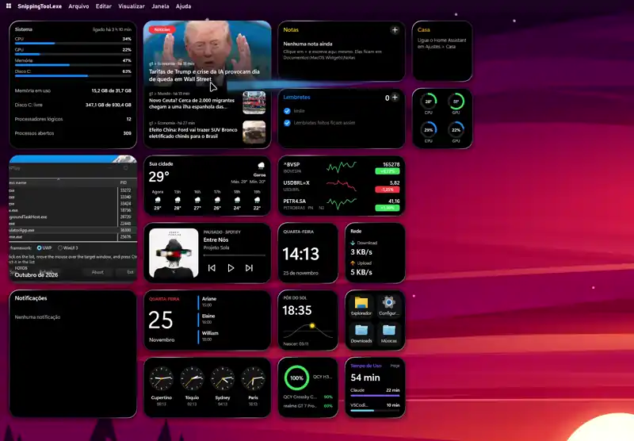
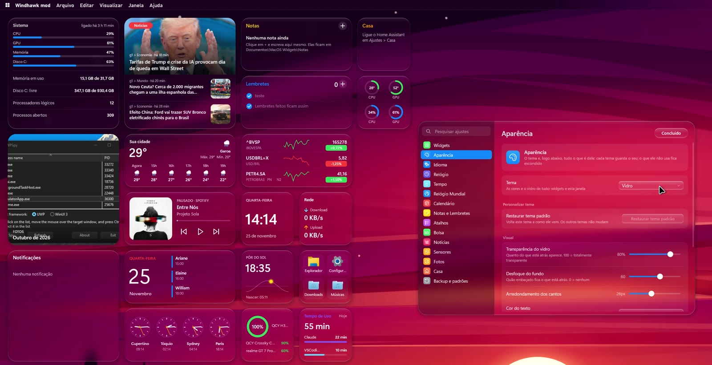
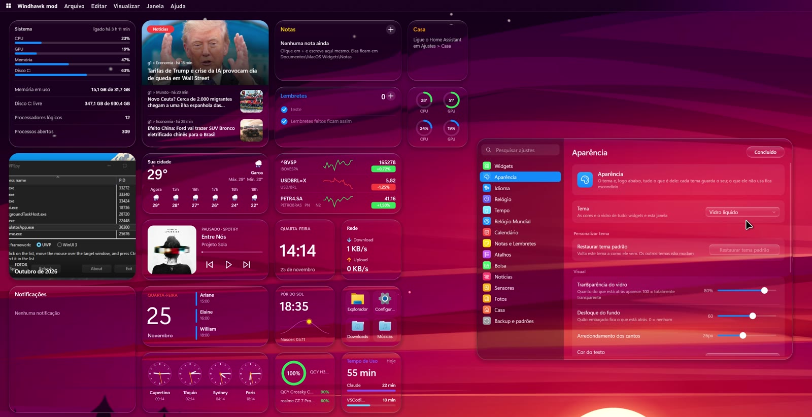
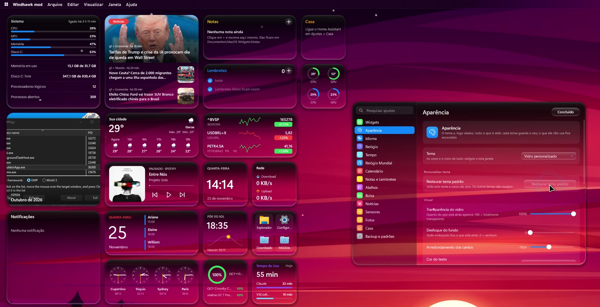
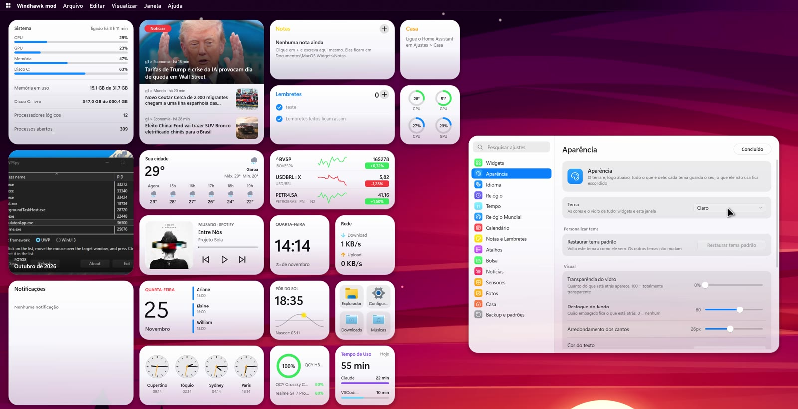
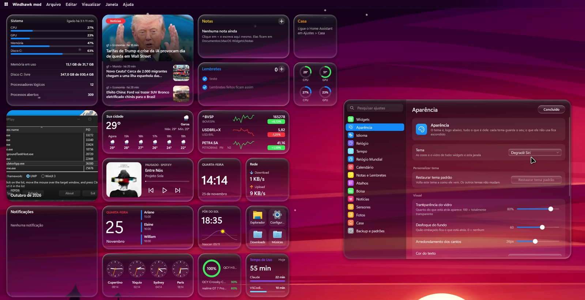
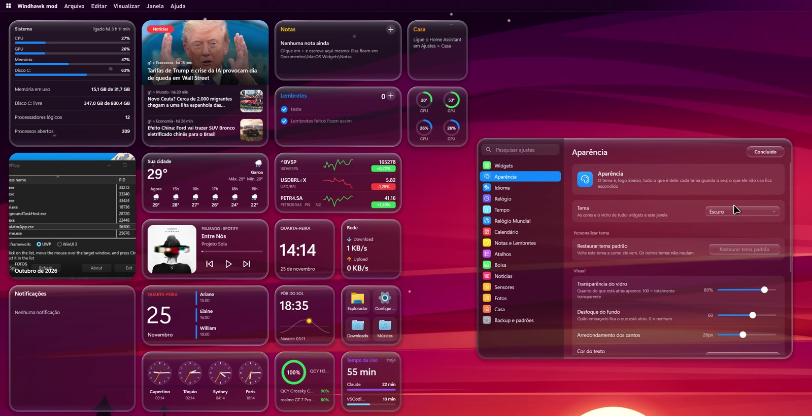
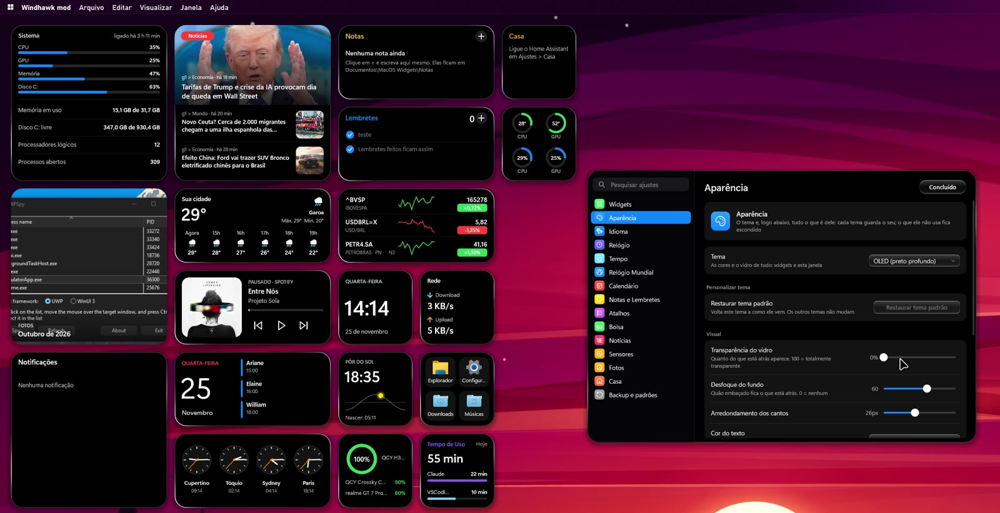

# MacOS Widgets

**English** | [Português](README.pt-BR.md)

A [Windhawk](https://windhawk.net) mod that brings macOS 27-style desktop widgets to Windows 11, with the same themes and the same Liquid Glass as [Siri Plus Launchpad](https://github.com/brideinflame-rgb/Siri-Plus-Launchpad).

▶️ [Watch the full demo video](screenshots/demo.mp4)

---

## Highlights

- **19 widgets** in up to four sizes (small, medium, large and extra large, a portrait size as in macOS 27)
- **Its own process**: the widgets run in a dedicated Windhawk process, not inside Explorer, so a problem in them can never take the taskbar or the desktop down
- **Live glass**: the glass follows what changes behind it (videos and animated wallpapers), even while you drag a widget
- **Mac-like grid**: drag a widget and a glass outline shows the cell where it will go; *Arrange Widgets* puts them all in order without leaving any out
- **Write in the widgets**: Notes and Reminders are edited right in the widget, with selection, copy and paste
- **Settings window** in the style of Siri Plus, with one section per widget, search, backup and 7 languages

## Widgets

| Widget | What it shows |
|---|---|
| **Clock** | Time and date, with hands, digital or both |
| **Weather** | Now, the next hours and the next days (Open-Meteo, no API key); the moon at night |
| **Music** | What's playing, with the cover and previous / play-pause / next; a click opens the player |
| **System** | CPU, GPU, memory and drive C: |
| **Calendar** | Today, the month and the next events from iCal links or .ics files |
| **World Clock** | Up to 4 cities |
| **Sunrise** | Sunrise and sunset in the Weather city |
| **Batteries** | The PC's and those of Bluetooth devices that report it to Windows |
| **Network** | Download and upload, now and over the last minute |
| **Photos** | A photo from your OneDrive Pictures, changed every 20 minutes |
| **Notifications** | The notifications that reach Windows (WhatsApp, Instagram, Outlook…) |
| **Notes** | Text notes written right in the widget |
| **Reminders** | A to-do list to check off |
| **Shortcuts** | Apps (Store apps too), folders and sites, chosen from a list |
| **Stocks** | Stocks, indexes, currencies and crypto (Yahoo Finance) |
| **News** | Headlines with covers from any site or RSS feed, newest first; the mouse wheel goes through them |
| **Screen Time** | How long you spent in each app today |
| **Sensors** | CPU/GPU temperatures, usage, clock, fan, power… live, you choose each slot (CPU temperature needs [LibreHardwareMonitor](https://github.com/LibreHardwareMonitor/LibreHardwareMonitor)) |
| **Home** | Lights, plugs, scenes and sensors from [Home Assistant](https://www.home-assistant.io) (SmartThings, Matter and the device brands); favorites chosen from a list |

## Themes

The seven themes of Siri Plus. Each one keeps its own transparency, blur, refraction, effects and colors.

| | | |
|:-:|:-:|:-:|
|  **Glass** |  **Liquid glass** |  **Custom glass** |
|  **Light** |  **Siri gradient** |  **Dark** |
|  **OLED** | | |

## Languages

Português, English, Español, Français, Deutsch, Italiano and 中文（简体）. *Automatic* follows the language of Windows.

## Installation

1. Install [Windhawk](https://windhawk.net).
2. Search for **MacOS Widgets** in Windhawk's mod browser and click *Install*.
   Before it's published there: in Windhawk, click *Create a new mod*, replace the code with [`macos-widgets.wh.cpp`](macos-widgets.wh.cpp) and click *Compile Mod*.
3. Right-click any widget to turn on more widgets and open the settings.

## Use

- **Drag** a widget to move it; it snaps into the grid.
- **Click** opens what the widget shows (the player, the forecast, Task Manager…).
- **Right-click**: size, show/hide each widget, *Arrange Widgets* and *MacOS Widgets Settings…*

## Network access
Nothing is sent anywhere unless a widget that needs it is on. No API keys, no accounts, no telemetry.

| Host | What is sent | When | Turned off by |
|---|---|---|---|
| api.open-meteo.com | Your city's latitude and longitude | Every 15 min and on settings changes | Weather and Sunrise off (nothing before a city is chosen) |
| geocoding-api.open-meteo.com | The city name you type | When you search for a city | — |
| query1.finance.yahoo.com | The stock symbols | Every 5 min | Stocks off (default) |
| The news sites you add, and the hosts of their cover images | Nothing beyond the request | Every 15 min; finding a site's feed takes up to 10 more requests (announced feeds, feed-like links, /feed, /rss…), a site that fails is left alone for up to 60 min | News off (default) |
| Your calendar links | The link (a private iCal link includes its secret token) | Every 15 min | Calendar off (default) |
| Your Home Assistant | Your access token | The widget's entities every 5 s, the whole list every 5 min, and on each tap | Home off (default) or no token |

The default Home Assistant address is plain `http://`, so the token travels unencrypted on your network unless you use an `https://` address.

Notes and reminders are saved in `Documents\MacOS Widgets` (`Notes` folder and `Reminders.txt`), created only when you save the first one; they stay when the mod is removed.

## Support the project
If you enjoy MacOS Widgets, you can support its development with a Pix donation:

**[Donate with LivePix (Pix)](https://livepix.gg/kurokobr)**

## License

[GPL-3.0](LICENSE) © Thiago Silva
