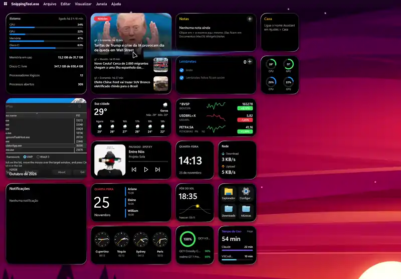
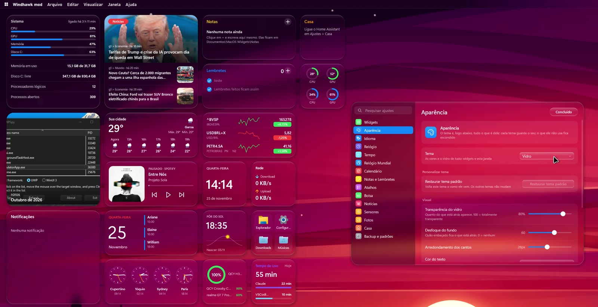
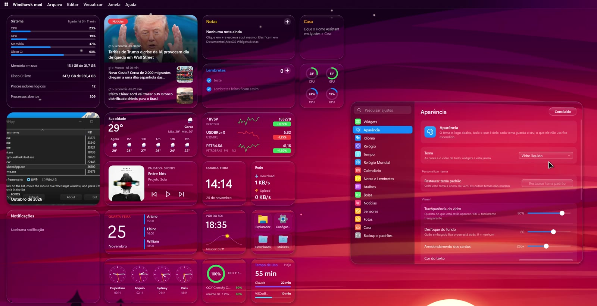
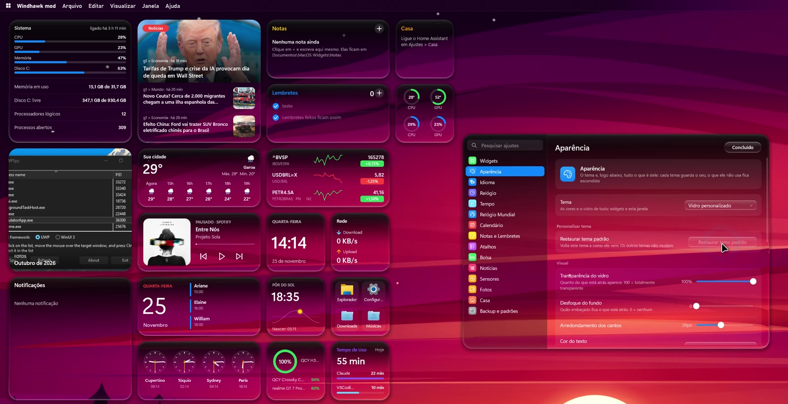
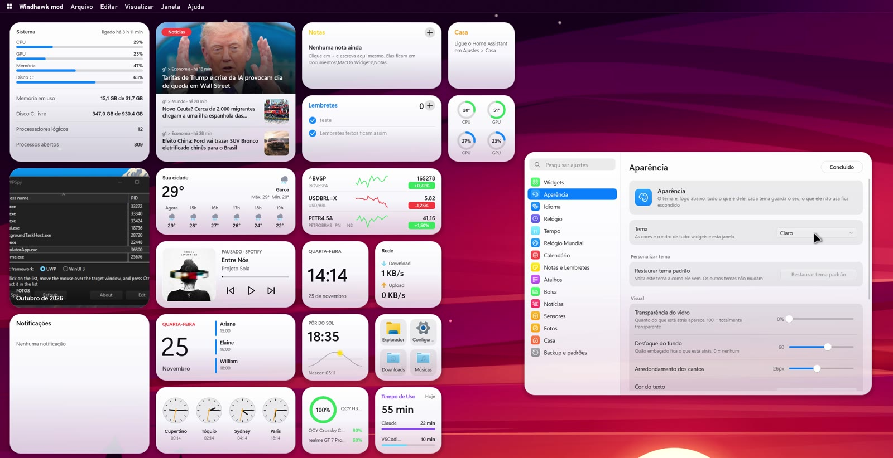
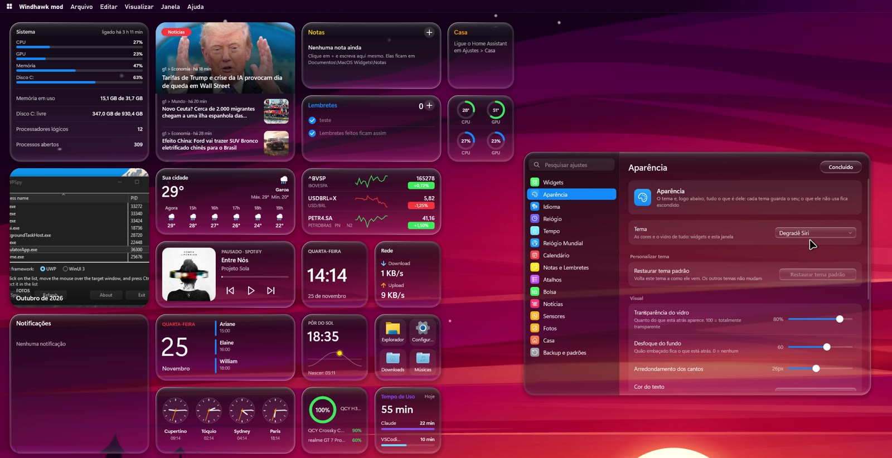
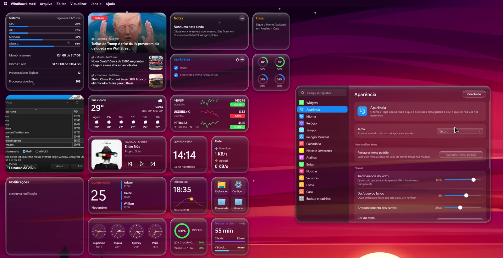
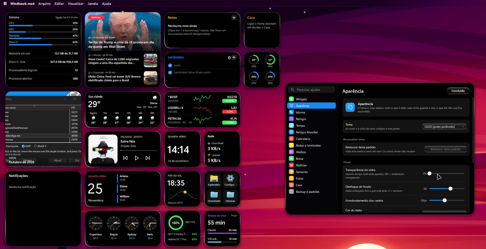

# MacOS Widgets

[English](README.md) | **Português**

Um mod do [Windhawk](https://windhawk.net) que traz para o Windows 11 os widgets de área de trabalho no estilo do macOS 27, com os mesmos temas e o mesmo Liquid Glass do [Siri Plus Launchpad](https://github.com/brideinflame-rgb/Siri-Plus-Launchpad).

▶️ [Veja o vídeo completo](screenshots/demo.mp4)

---

## Destaques

- **19 widgets** em até quatro tamanhos (pequeno, médio, grande e extra-grande, em retrato como no macOS 27)
- **Processo próprio**: os widgets rodam num processo do Windhawk só deles, fora do Explorer; um problema neles nunca derruba a barra de tarefas nem a área de trabalho
- **Vidro ao vivo**: o vidro acompanha o que muda atrás dele (vídeos e papéis de parede animados), inclusive enquanto você arrasta o widget
- **Grade como no Mac**: ao arrastar, um contorno de vidro mostra a casa onde o widget vai ficar; *Organizar Widgets* põe todos em ordem sem deixar nenhum de fora
- **Escreva nos widgets**: Notas e Lembretes são editados no próprio widget, com seleção, copiar e colar
- **Janela de ajustes** no estilo do Siri Plus, com uma seção para cada widget, pesquisa, backup e 7 idiomas

## Widgets

| Widget | O que mostra |
|---|---|
| **Relógio** | Hora e data, com ponteiros, digital ou os dois |
| **Tempo** | Agora, as próximas horas e os próximos dias (Open-Meteo, sem chave); a lua à noite |
| **Música** | O que está tocando, com a capa e anterior / tocar-pausar / próxima; um clique abre o player |
| **Sistema** | CPU, GPU, memória e disco C: |
| **Calendário** | Hoje, o mês e os próximos eventos de links iCal ou arquivos .ics |
| **Relógio Mundial** | Até 4 cidades |
| **Nascer do Sol** | Nascer e pôr do sol na cidade do Tempo |
| **Baterias** | A do PC e a dos aparelhos Bluetooth que a informam ao Windows |
| **Rede** | Download e upload, agora e no último minuto |
| **Fotos** | Uma foto das suas Imagens do OneDrive, trocada a cada 20 minutos |
| **Notificações** | As notificações que chegam no Windows (WhatsApp, Instagram, Outlook…) |
| **Notas** | Notas de texto escritas no próprio widget |
| **Lembretes** | Uma lista de tarefas para marcar como feitas |
| **Atalhos** | Apps (da Loja também), pastas e sites, escolhidos numa lista |
| **Bolsa** | Ações, índices, moedas e cripto (Yahoo Finance) |
| **Notícias** | Manchetes com capa de qualquer site ou feed RSS, as mais novas primeiro; a roda do mouse passa as notícias |
| **Tempo de Uso** | Quanto tempo você passou em cada app hoje |
| **Sensores** | Temperaturas de CPU/GPU, uso, clock, ventoinha, consumo… ao vivo, você escolhe cada espaço (a temperatura da CPU precisa do [LibreHardwareMonitor](https://github.com/LibreHardwareMonitor/LibreHardwareMonitor)) |
| **Casa** | Luzes, tomadas, cenas e sensores do [Home Assistant](https://www.home-assistant.io) (SmartThings, Matter e as marcas dos aparelhos); favoritos escolhidos numa lista |

## Temas

Os sete temas do Siri Plus. Cada um guarda sua própria transparência, desfoque, refração, efeitos e cores.

| | | |
|:-:|:-:|:-:|
|  **Vidro** |  **Vidro líquido** |  **Vidro personalizado** |
|  **Claro** |  **Degradê Siri** |  **Escuro** |
|  **OLED** | | |

## Idiomas

Português, English, Español, Français, Deutsch, Italiano e 中文（简体）. *Automático* segue o idioma do Windows.

## Instalação

1. Instale o [Windhawk](https://windhawk.net).
2. Procure **MacOS Widgets** na lista de mods do Windhawk e clique em *Instalar*.
   Antes de ele ser publicado lá: no Windhawk, clique em *Criar um novo mod*, troque o código pelo de [`macos-widgets.wh.cpp`](macos-widgets.wh.cpp) e clique em *Compilar mod*.
3. Clique com o botão direito em qualquer widget para ligar outros widgets e abrir os ajustes.

## Uso

- **Arraste** um widget para movê-lo; ele encaixa na grade.
- **Clique** abre o que o widget mostra (o player, a previsão, o Gerenciador de Tarefas…).
- **Botão direito**: tamanho, mostrar/esconder cada widget, *Organizar Widgets* e *Ajustes do MacOS Widgets…*

## Licença

[GPL-3.0](LICENSE) © Thiago Silva
